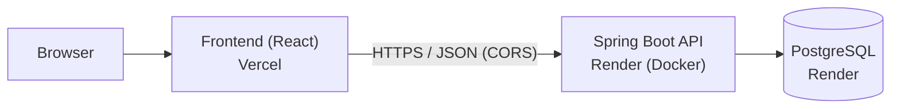

# SalonBooking

Salon appointment booking system: a Spring Boot REST API with PostgreSQL, and a React frontend, deployed on Render and Vercel.

## Links

| What | Link |
|---|---|
| Source code (GitHub) | https://github.com/TamarGagnide/SalonBooking |
| Live frontend (Vercel) | https://salonbooking-frontend-flame.vercel.app/ |
| Live backend API (Render) | https://salonbooking-api.onrender.com |
| Backend health check | https://salonbooking-api.onrender.com/actuator/health |

> The backend runs on a free Render plan that sleeps when idle. The first request after a pause can take 30-60 seconds.

## Table of Contents

1. [What this project is](#what-this-project-is)
2. [Current status](#current-status)
3. [Tech stack](#tech-stack)
4. [Architecture: why a monolith?](#architecture-why-a-monolith)
5. [Repository structure](#repository-structure)
6. [Design decisions explained](#design-decisions-explained)
7. [Frontend](#frontend)
8. [API overview](#api-overview)
9. [Running locally](#running-locally)
10. [Testing and CI](#testing-and-ci)
11. [Deployment: Vercel + Render](#deployment-vercel--render)
12. [Known limitations and next steps](#known-limitations-and-next-steps)
13. [Requirements](#requirements)

## What this project is

Customers can browse salon services, choose a stylist, check available time slots, and book or cancel appointments. Stylists see their schedules and the salon administrator manages services and working hours. The goal of the system is to replace manual scheduling and **prevent two customers from booking the same stylist at the same time**.

The core engineering problem is the no-double-booking rule (see [Design decisions explained](#design-decisions-explained)).


## Current status

| Part | State |
|---|---|
| Requirements (stakeholders, NFRs, MVP stories) | Written (see bottom of this file) |
| Backend: register, login, availability, book, cancel | Implemented and tested |
| Backend: list services/stylists, my appointments, schedules, admin | **Not implemented yet** (domain model exists) |
| Frontend | Minimal demo only: register, login, check availability, book, cancel. Deployed on Vercel |
| CI (GitHub Actions) | Working: runs tests against Postgres |
| Deployment | Backend and database live on Render, frontend live on Vercel. CORS between them works (preflight request from the Vercel URL returns 200) |
| Demo data | **None yet**, so booking needs manual SQL inserts for now |
| Authentication | Simplified: no tokens or sessions (see limitations) |

## Tech stack

| Layer | Technology | Why it is here |
|---|---|---|
| Backend | Java 21, Spring Boot 3.3 (Web, Data JPA, Validation, Actuator, Security-Crypto) | Common, well documented, good for layered design |
| Database | PostgreSQL 16 | Relational data, plus a constraint type that prevents overlaps |
| Frontend | React 18 + Vite | Simple SPA, easy to host statically |
| Tests | JUnit 5, Mockito | Unit tests and integration tests |
| Containers | Docker, docker-compose | Same environment locally and in the cloud |
| CI | GitHub Actions | Runs the tests on every push |
| Hosting | Vercel (frontend), Render (backend + Postgres) | Free tiers, GitHub integration |

## Architecture: why a monolith?

SalonBooking is a **monolith, not microservices**: one Spring Boot application, one database, one deployable. Inside, it is split into layers (`api` → `service` → `repository` → `domain`), which makes it a *modular* monolith.



The reasoning, in order of importance:

1. **The requirements don't call for distribution.** NFR-02 asks for about 50 concurrent users. One Spring Boot instance on Postgres handles that. Microservices would add network calls and complexity to solve a scaling problem that does not exist.
2. **The key rule is easier inside one database.** "No overlapping appointments" is a transactional, relational rule. In one database, Postgres can enforce it directly. Across several services I would need distributed transactions or sagas for the most important rule in the system.
3. **One developer.** Microservices help when separate teams own separate services. For one person they mostly add overhead (gateways, per-service pipelines, distributed debugging).
4. **Cost and simplicity.** One container and one database fit free hosting tiers.
5. **It can be split later.** The package boundaries map onto a possible split (Identity, Catalog, Availability, Booking, Admin).

**Trade-off I accepted:** the whole backend scales and fails as one unit. That is fine at this size.

**Frontend and backend are separate deployables.** They live in separate folders and deploy to different platforms. That is a normal client/server split and does not make the system microservices.

## Repository structure

```
SalonBooking/
├── backend/                  Spring Boot API
│   ├── src/main/java/com/salonbooking/
│   │   ├── api/              Controllers, DTOs, exception handling
│   │   ├── service/          Business rules (overlap, working hours, access control)
│   │   ├── repository/       Spring Data JPA repositories
│   │   └── domain/           Entities (Customer, Stylist, SalonService, WorkingHours, Appointment)
│   ├── src/main/resources/   application.yml, schema.sql
│   ├── src/test/             Unit + integration tests
│   ├── Dockerfile            Multi-stage build (used by Render)
│   ├── docker-compose.yml    Local Postgres
│   └── pom.xml
├── frontend/                 React + Vite demo UI (Vercel)
├── docs/                     ARCHITECTURE.md, TESTING.md
├── render.yaml               Render Blueprint (API + database)
└── .github/workflows/ci.yml  CI pipeline
```

## Design decisions explained

**Why PostgreSQL and not NoSQL?** Appointments are relational (customer, stylist, service, time range). Postgres has an `EXCLUDE USING gist` constraint (with the `btree_gist` extension) that rejects overlapping active appointments for the same stylist *inside the database*.

**Why check overlaps twice?** The service layer checks availability first so it can return a friendly error. But two requests can pass that check at the same instant (a race condition). The database constraint is the real safety net: one of the two inserts fails. An integration test proves this against real Postgres.

**Why only `spring-security-crypto`?** Full Spring Security (sessions, tokens, filters) is a big topic. For this stage I only hash passwords with BCrypt and check access rules in the service layer (a customer can only cancel their own appointment).

**Why environment variables for config?** The same Docker image should run locally and on Render. Database credentials, port and allowed frontend origins come from env vars with local defaults.

**Why CORS?** The frontend (Vercel) and backend (Render) are different origins. Browsers block calls between them unless the backend explicitly allows the frontend's URL (`CORS_ALLOWED_ORIGINS`).

## Frontend

The frontend (`frontend/`) is a small React 18 + Vite single-page app, built to try the API from a browser and to practice deploying a static site on Vercel. Live: https://salonbooking-frontend-flame.vercel.app/

- **Pages/flows:** register, log in, check a stylist's availability for a time slot, book it, cancel it.
- **Structure:** `src/api.js` (all `fetch` calls, base URL from `VITE_API_URL`), `src/App.jsx` (auth form and booking screen), `src/styles.css` (theme).
- **Styling:** plain CSS with a soft pink/mauve palette from Coolors (`#d6c7cf #c6bbc1 #d5cbd0 #e8dce2 #ebe1e6 #f2e4ea #f2e4eb #f6e7ee #f4e6ed #f6ebf0`). These are very light, so text and buttons use darker plum tones derived from them.
- **Config:** `VITE_API_URL` is the backend URL. Vite bakes it into the build, so it must be set in Vercel *before* deploying.
- **Limits:** the backend has no list endpoints yet, so stylist and service are typed as IDs and the bookings list only shows the current session. Login state is just the user object in `localStorage` (no tokens).

More detail in [`frontend/README.md`](frontend/README.md).

## API overview

| Method | Path | Purpose |
|---|---|---|
| POST | `/api/customers` | Register (SALON-01) |
| POST | `/api/auth/login` | Log in (SALON-02) |
| GET | `/api/stylists/{stylistId}/availability` | Check a time slot (SALON-05) |
| POST | `/api/appointments` | Book (SALON-06) |
| DELETE | `/api/appointments/{appointmentId}` | Cancel (SALON-08) |
| GET | `/actuator/health` | Health check (used by Render) |

## Running locally

Needs JDK 21, Maven, Docker and Node.

```bash
# Backend
cd backend
docker-compose up -d postgres     # local database
mvn spring-boot:run               # http://localhost:8080

# Frontend (second terminal)
cd frontend
cp .env.example .env              # VITE_API_URL=http://localhost:8080
npm install
npm run dev                       # http://localhost:5173
```

Backend settings can be overridden with `DB_HOST`, `DB_PORT`, `DB_NAME`, `DB_USER`, `DB_PASSWORD`, `PORT`, `CORS_ALLOWED_ORIGINS`.

## Testing and CI

```bash
cd backend
mvn test     # integration tests need Postgres running
```

- 11 tests: 9 unit tests (overlap logic, booking rules, access control) and 2 integration tests (Postgres rejecting a double-booking insert).
- GitHub Actions (`.github/workflows/ci.yml`) runs the tests against a Postgres service on every push and pull request.


## Deployment: Vercel + Render

```
GitHub repo ──push──► Vercel  (builds frontend/, serves static files from a CDN)
            └─push──► Render  (builds backend/Dockerfile, runs API + Postgres)
```

### Why two platforms?

- **Vercel** is made for static sites and SPAs: CDN, HTTPS and automatic deploys on every push.
- **Render** can run a long-lived Docker container and a managed Postgres, which a Spring Boot app needs (warm JVM, database connection pool). Vercel is built for short serverless functions, so it is a poor fit for this backend.

Using each for what it does best also lets the two folders deploy independently.

### How the two connect

- The frontend calls the backend at `VITE_API_URL`. Vite bakes this value into the build, so it must be set in Vercel before the build runs.
- The backend only accepts browser calls from origins listed in `CORS_ALLOWED_ORIGINS` (for example `https://salonbooking-frontend-flame.vercel.app,http://localhost:5173`, exact URL, no trailing slash).
- Render builds `backend/Dockerfile` (`rootDir: backend`) and creates the Postgres database from `render.yaml`. Vercel builds `frontend/` with the Vite preset.

### Environment variables

| Variable | Where | Purpose |
|---|---|---|
| `DB_HOST`, `DB_PORT`, `DB_NAME`, `DB_USER`, `DB_PASSWORD` | Render (from `render.yaml`) | Database connection |
| `PORT` | Render (injected) | HTTP port |
| `CORS_ALLOWED_ORIGINS` | Render (manual) | Frontend URL(s) allowed to call the API |
| `VITE_API_URL` | Vercel | Backend URL |

### Free-tier notes

- Render's free web service sleeps after about 15 minutes idle, so the first request can take 30-60 seconds.
- Render's free Postgres has historically been time-limited, so data may not last. Check current terms.

## Known limitations and next steps

Not implemented or simplified at this stage:

- **No seed data and no admin API**, so stylists, services and working hours must be inserted manually in SQL before booking works.
- **Missing endpoints** for browsing services/stylists, "my appointments", stylist schedules and admin management (SALON-03/04/07/09/10/11).
- **Simplified authentication.** Login returns the customer record, and the client sends its own `customerId`. A real system would issue tokens (for example JWT) and read the identity from them on the server, so one user cannot act as another. As it stands this weakens the NFR-04 guarantee.
- **Frontend is a demo.** Stylist and service are typed as ID numbers, and bookings only show for the current session.
- **No load test yet** for NFR-01/02 (2 seconds at 50 users).
- **Deployment not hardened:** no staging, no monitoring, free-tier limits.
- **No coverage report.** Suggestion for later: add the Jacoco Maven plugin and upload its report from CI, then add `@WebMvcTest` tests for the controllers.

---

# Requirements

## Stakeholders

| Role | Responsibilities and interests |
|---|---|
| Customer | Wants to find suitable services and book appointments quickly. |
| Stylist | Wants an accurate schedule and clear information about upcoming appointments. |
| Salon Administrator / Owner | Wants to manage services, stylists, schedules, and bookings efficiently. |

**Who pays:** The salon owner funds the system.

**Veto authority:** The salon owner has the final say on business requirements and salon policies. The developer determines the technical implementation within the agreed scope.

## Project Scope

The initial version supports one salon with multiple stylists and services.

The system will support customer accounts, service browsing, appointment availability, booking and cancellation, stylist schedules, and administrative management of services and working hours.

Online payments, customer reviews, loyalty programs, email reminders, and multiple salon branches are outside the initial MVP scope.

## Non-Functional Requirements

**NFR-01 — Performance:** The system must return service lists and appointment availability results within 2 seconds for at least 95% of requests under a test load of 50 concurrent users.

**NFR-02 — Concurrent Usage:** The system must support at least 50 simultaneous users without crashing or losing booking data.

**NFR-03 — Booking Integrity:** The system must prevent overlapping active appointments for the same stylist, including when multiple customers attempt to book the same time slot simultaneously.

**NFR-04 — Access Control:** The system must prevent unauthorized access to customer appointments and administrative functions. Automated tests must verify access permissions for each user role.

## Definition of Done

A user story is considered complete when:

- The functionality meets all defined acceptance criteria.
- Input validation and error handling are implemented where required.
- Access permissions are enforced for protected functionality.
- Relevant automated tests pass.
- The code is reviewed and merged into the main branch.
- The application builds and runs successfully.
- Relevant documentation is updated.

## MVP Scope

The Minimum Viable Product (MVP) supports one salon with multiple stylists and services. It includes customer registration and login, browsing services and stylists, checking availability, booking and cancelling appointments, viewing personal appointments, viewing stylist schedules, managing salon services, and configuring stylist working hours.

### MVP User Stories

| Issue | User Story | Points |
|---|---|---:|
| SALON-01 | Customer Registration | 3 |
| SALON-02 | Customer Login | 3 |
| SALON-03 | Browse Salon Services | 2 |
| SALON-04 | View Salon Stylists | 2 |
| SALON-05 | Check Appointment Availability | 5 |
| SALON-06 | Book an Appointment | 5 |
| SALON-07 | View My Appointments | 3 |
| SALON-08 | Cancel an Appointment | 3 |
| SALON-09 | View Stylist Schedule | 3 |
| SALON-10 | Manage Salon Services | 5 |
| SALON-11 | Manage Stylist Working Hours | 5 |
| **Total** | **11 user stories** | **39** |

All listed stories are classified as **Must have** and form the MVP.

### Out of Scope for the MVP

- Online payments
- Customer reviews and ratings
- Loyalty and rewards programs
- Email reminders
- Multiple salon branches

