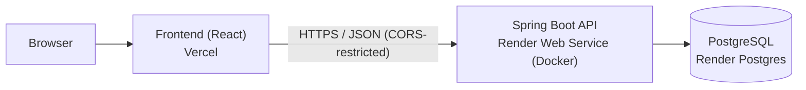

# SalonBooking

Salon appointment reservation system: customers browse services and stylists, check availability, and book or cancel appointments, while the system guarantees that no stylist is ever double-booked.

## Table of Contents

1. [Project Description](#project-description)
2. [Tech Stack](#tech-stack)
3. [Architecture: Modular Monolith](#architecture-modular-monolith)
4. [Repository Structure](#repository-structure)
5. [Key Design Decisions](#key-design-decisions)
6. [API Overview](#api-overview)
7. [Running Locally](#running-locally)
8. [Testing and CI](#testing-and-ci)
9. [Deployment: Vercel + Render](#deployment-vercel--render)
10. [Further Documentation](#further-documentation)
11. [Requirements: Stakeholders, Scope, NFRs, MVP](#requirements)

## Project Description

SalonBooking is a web application designed to simplify appointment booking at a beauty salon. Customers can browse salon services, choose a stylist, view available time slots, and book or cancel appointments. Stylists can view their schedules, while the salon administrator manages services, stylists, and working hours. The system aims to reduce manual scheduling and prevent appointment conflicts.

**Current status:** the backend slice that carries the hardest requirements (registration, login, availability, booking, cancellation, no-overlap guarantee, access control) is implemented and tested. A minimal React frontend (`frontend/`: register, login, check availability, book, cancel) is built and ready for Vercel.

## Tech Stack

| Layer | Technology | Notes |
|---|---|---|
| Backend | Java 21, Spring Boot 3.3 (Web, Data JPA, Validation, Actuator, Security-Crypto) | REST API, BCrypt password hashing |
| Database | PostgreSQL 16 | Relational model; `EXCLUDE` constraint enforces no double-booking |
| Frontend | React 18 + Vite | Static SPA, hosted on Vercel |
| Build / tests | Maven, JUnit 5, Jacoco | Unit + integration tests against real Postgres |
| Containers | Docker, docker-compose | Dockerfile for the API; compose for local Postgres |
| CI | GitHub Actions | Runs the full test suite against a Postgres service on every push/PR |
| Hosting | Vercel (frontend), Render (backend + Postgres) | Backend defined as code in `render.yaml` |

## Architecture: Modular Monolith

SalonBooking is a **monolith, not microservices**: one Spring Boot application, one deployable artifact, one database. Internally it is split into clear layers (`api` → `service` → `repository` → `domain`), so it is a *modular* monolith.



**Why a monolith?**

1. **The requirements don't need distribution.** NFR-02 asks for about 50 concurrent users. A single Spring Boot instance on a well-indexed Postgres handles that comfortably. Microservices would add network hops, eventual consistency and operational overhead to solve a scaling problem that doesn't exist.
2. **Booking integrity is easier in one place.** The core guarantee (NFR-03, no overlapping appointments) is a transactional, relational concern. Keeping bookings, availability and customers in one database lets Postgres enforce it directly. Splitting these across services would force distributed transactions or sagas for the most important rule in the system.
3. **Team of one.** Microservices pay off when separate teams own separate services. A solo developer would pay the cost (service discovery, API gateway, per-service pipelines, distributed debugging) without the benefit.
4. **Cost and simplicity.** One container, one database, one pipeline. This fits free or low-cost hosting.
5. **It can be split later.** The package boundaries map directly onto a service decomposition (Identity, Catalog, Availability, Booking-Core, Admin). `docs/CLOUD_NATIVE.md` sketches that split as a design exercise. The plan is "rehost the monolith now, refactor only when real load justifies it".

The trade-off accepted: the whole backend scales and fails as one unit. That is fine at this scale, and the risk is documented in `docs/ARCHITECTURE.md`.

**Frontend and backend are separate deployables.** They live in separate folders and deploy independently to different platforms. That is a normal client/server split, not a microservice split: there is still a single backend service.

## Repository Structure

```
SalonBooking/
├── backend/                  Spring Boot API
│   ├── src/main/java/com/salonbooking/
│   │   ├── api/              Controllers, DTOs, exception handling
│   │   ├── service/          Business logic (overlap, working hours, access control)
│   │   ├── repository/       Spring Data JPA repositories
│   │   └── domain/           Entities (Customer, Stylist, SalonService, WorkingHours, Appointment)
│   ├── src/main/resources/   application.yml, schema.sql
│   ├── src/test/             Unit + integration tests
│   ├── Dockerfile            Multi-stage build used by Render
│   ├── docker-compose.yml    Local Postgres
│   └── pom.xml
├── frontend/                 React + Vite app, deployed to Vercel
├── docs/                     ARCHITECTURE.md, CLOUD_NATIVE.md, TESTING.md
├── render.yaml               Render Blueprint (API + Postgres)
└── .github/workflows/ci.yml  CI pipeline
```

## Key Design Decisions

- **PostgreSQL over NoSQL.** Appointments are relational (customer, stylist, service, time range). Postgres's `EXCLUDE USING gist` constraint (via `btree_gist`) rejects overlapping active appointments for the same stylist at the database level. This is the real safety net for NFR-03: it holds even under concurrent requests or if application code has a bug. The service layer also checks first, to return friendly errors.
- **Access control in the service layer (NFR-04).** Customers can only act on their own appointments. This is covered by automated tests.
- **BCrypt password hashing** via `spring-security-crypto`, without pulling in full Spring Security for the MVP.
- **Configuration through environment variables.** Database credentials, port and allowed CORS origins are read from env vars (with local defaults), so the same image runs locally and on Render.
- **Health endpoint.** `/actuator/health` is the only exposed actuator endpoint, used by Render for health checks.

## API Overview

| Method | Path | Purpose |
|---|---|---|
| POST | `/api/customers` | Register a customer (SALON-01) |
| POST | `/api/auth/login` | Log in (SALON-02) |
| GET | `/api/stylists/{stylistId}/availability` | Check open slots (SALON-05) |
| POST | `/api/appointments` | Book an appointment (SALON-06) |
| DELETE | `/api/appointments/{appointmentId}` | Cancel an appointment (SALON-08) |
| GET | `/actuator/health` | Health check |

Endpoints for browsing services and stylists, viewing appointments and schedules, and admin management are planned (SALON-03/04/07/09/10/11).

## Running Locally

Prerequisites: JDK 21, Maven, Docker.

```bash
# 1. Start Postgres
cd backend
docker-compose up -d postgres

# 2. Run the API (http://localhost:8080)
mvn spring-boot:run
```

Defaults match `docker-compose.yml`. Override with `DB_HOST`, `DB_PORT`, `DB_NAME`, `DB_USER`, `DB_PASSWORD`, `PORT` and `CORS_ALLOWED_ORIGINS` if needed. The schema is created from `schema.sql` on startup.

To build the container image instead:

```bash
docker build -t salonbooking-api backend
```

## Testing and CI

```bash
cd backend
mvn test          # unit + integration tests; integration tests need Postgres running
```

- 11 tests: 9 unit (overlap logic, booking rules, access control) and 2 integration (the real Postgres `EXCLUDE` constraint rejecting a double-booking insert).
- Jacoco coverage report: `backend/target/site/jacoco/index.html`.
- GitHub Actions (`.github/workflows/ci.yml`) runs the suite against a Postgres service container on every push and pull request to `main` and uploads the coverage report.

Details and captured output: `docs/TESTING.md`.

## Deployment: Vercel + Render

```
GitHub repo ──push──► Vercel  (builds frontend/, serves the static SPA from a CDN)
            └─push──► Render  (builds backend/Dockerfile, runs the API, managed Postgres)
```

### Why these two?

| Platform | Role | Why |
|---|---|---|
| **Vercel** | Frontend | Built for static and SPA hosting: global CDN, HTTPS, automatic deploys per push, preview deployments per pull request, generous free tier. |
| **Render** | Backend + database | Runs a long-lived Docker container (Spring Boot needs a warm JVM and pooled DB connections), offers managed Postgres alongside it, and supports infrastructure as code via `render.yaml`. |

Vercel is not a fit for the backend: it targets static sites and short-lived serverless functions, not a persistent JVM with a database connection pool. Render is not needed for the frontend: a CDN-served static site is cheaper and faster on Vercel. Splitting along that line uses each platform for what it does best, and the two folders deploy independently.

### Deploying the backend (Render)

1. Push the repo to GitHub.
2. In Render: **New → Blueprint**, select the repo. Render reads `render.yaml` and creates the `salonbooking-api` web service (Docker, `rootDir: backend`) and the `salonbooking-db` Postgres database. DB connection variables are wired in automatically.
3. In the service's environment settings, set `CORS_ALLOWED_ORIGINS` to your Vercel URL (for example `https://salonbooking.vercel.app`; comma-separate multiple origins).
4. Render health-checks `/actuator/health`. The schema is applied from `schema.sql` on first start.

### Deploying the frontend (Vercel)

1. In Vercel: **Add New → Project**, import the repo.
2. Set **Root Directory** to `frontend`.
3. Add the environment variable `VITE_API_URL` = your Render service URL (for example `https://salonbooking-api.onrender.com`).
4. Deploy. Every push to `main` redeploys; pull requests get preview URLs.

### Environment variables

| Variable | Where | Purpose |
|---|---|---|
| `DB_HOST`, `DB_PORT`, `DB_NAME`, `DB_USER`, `DB_PASSWORD` | Render (set by `render.yaml`) | Postgres connection |
| `PORT` | Render (injected) | HTTP port |
| `CORS_ALLOWED_ORIGINS` | Render (set manually) | Allowed frontend origin(s) |
| `VITE_API_URL` | Vercel | Backend base URL |

### Free-tier caveats

- Render's free web service **spins down after about 15 minutes idle**, so the first request after that can take 30-60 seconds. Acceptable for a demo; upgrade the plan for real use.
- Render's free Postgres has historically been **time-limited** (it has expired after 30 days). Check current terms, and move to a paid plan or an external free Postgres (Neon, Supabase) if the data must persist.
- The Docker build and `render.yaml` have not yet been run end to end, so expect to adjust on the first deploy.

## Further Documentation

- [`docs/ARCHITECTURE.md`](docs/ARCHITECTURE.md): architecture style, component diagram, data model, risks.
- [`docs/CLOUD_NATIVE.md`](docs/CLOUD_NATIVE.md): microservice decomposition exercise, 6R, serverless vs container, edge/fog, quantum risk.
- [`docs/TESTING.md`](docs/TESTING.md): test strategy, real run output, coverage.

---

# Requirements

## Stakeholders

| Role | Responsibilities and interests |
|---|---|
| Customer | Wants to find suitable services and book appointments quickly. |
| Stylist | Wants an accurate schedule and clear information about upcoming appointments. |
| Salon Administrator / Owner | Wants to manage services, stylists, schedules, and bookings efficiently. |

**Who pays:** The salon owner funds the system.

**Veto authority:** The salon owner has the final say on business requirements and salon policies. The developer determines the technical implementation within the agreed scope.

## Project Scope

The initial version supports one salon with multiple stylists and services.

The system will support customer accounts, service browsing, appointment availability, booking and cancellation, stylist schedules, and administrative management of services and working hours.

Online payments, customer reviews, loyalty programs, email reminders, and multiple salon branches are outside the initial MVP scope.

## Non-Functional Requirements

**NFR-01 — Performance:** The system must return service lists and appointment availability results within 2 seconds for at least 95% of requests under a test load of 50 concurrent users.

**NFR-02 — Concurrent Usage:** The system must support at least 50 simultaneous users without crashing or losing booking data.

**NFR-03 — Booking Integrity:** The system must prevent overlapping active appointments for the same stylist, including when multiple customers attempt to book the same time slot simultaneously.

**NFR-04 — Access Control:** The system must prevent unauthorized access to customer appointments and administrative functions. Automated tests must verify access permissions for each user role.

## Definition of Done

A user story is considered complete when:

- The functionality meets all defined acceptance criteria.
- Input validation and error handling are implemented where required.
- Access permissions are enforced for protected functionality.
- Relevant automated tests pass.
- The code is reviewed and merged into the main branch.
- The application builds and runs successfully.
- Relevant documentation is updated.

## MVP Scope

The Minimum Viable Product (MVP) supports one salon with multiple stylists and services. It includes customer registration and login, browsing services and stylists, checking availability, booking and cancelling appointments, viewing personal appointments, viewing stylist schedules, managing salon services, and configuring stylist working hours.

### MVP User Stories

| Issue | User Story | Points |
|---|---|---:|
| SALON-01 | Customer Registration | 3 |
| SALON-02 | Customer Login | 3 |
| SALON-03 | Browse Salon Services | 2 |
| SALON-04 | View Salon Stylists | 2 |
| SALON-05 | Check Appointment Availability | 5 |
| SALON-06 | Book an Appointment | 5 |
| SALON-07 | View My Appointments | 3 |
| SALON-08 | Cancel an Appointment | 3 |
| SALON-09 | View Stylist Schedule | 3 |
| SALON-10 | Manage Salon Services | 5 |
| SALON-11 | Manage Stylist Working Hours | 5 |
| **Total** | **11 user stories** | **39** |

All listed stories are classified as **Must have** and form the MVP.

### Out of Scope for the MVP

- Online payments
- Customer reviews and ratings
- Loyalty and rewards programs
- Email reminders
- Multiple salon branches

