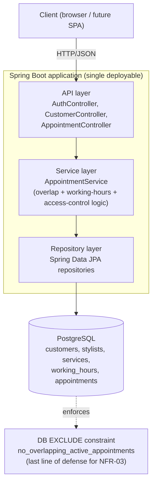

# Architecture

**Scenario:** D — own idea. The product is SalonBooking itself (see `README.md` for scope, stakeholders, NFR-01..04, and the MVP story list). This document chooses and justifies the architecture for that product.

This milestone implements the slice of the MVP that carries the hardest non-functional requirement — NFR-03 (no overlapping appointments) and NFR-04 (access control) — end to end: `SALON-01` (register), `SALON-02` (login), `SALON-05` (check availability), `SALON-06` (book), `SALON-08` (cancel). The remaining stories (`SALON-03/04/07/09/10/11`) have their domain model in place (`Stylist`, `SalonService`, `WorkingHours`) but no API yet; they're deferred to a later milestone of this 3-4 month project.

## Architecture style: layered modular monolith

A single Spring Boot application, internally split into clear layers/packages (`domain`, `repository`, `service`, `api`), not a distributed microservice system.

1. **The NFR targets don't justify distributed-systems overhead.** NFR-02 asks for ≥50 concurrent users; a single well-indexed Postgres-backed Spring Boot instance handles that comfortably. Splitting into services now would add network calls, eventual consistency, and operational surface area to solve a scaling problem that doesn't exist yet.
2. **Team of one.** Microservices trade development simplicity for independent deployability and fault isolation — a trade that only pays off with a team large enough to own separate services. A solo developer pays the distributed-systems tax without the benefit.
3. **Lower cost and operational complexity for a student project with no live cloud account yet** (see `CLOUD_NATIVE.md`) — one deployable artifact, one database, one `backend/docker-compose.yml`.

The package boundaries are deliberately clean (see diagram below) so this *can* be decomposed later — that contrast is explored in `CLOUD_NATIVE.md` step 8, which treats the same system as a microservices design exercise.

## Component diagram



The service layer checks availability *before* writing (fast rejection with a clear error); the database's `EXCLUDE` constraint catches the rare case where two requests race past that check concurrently (see `AppointmentService.bookAppointment`, which catches `DataIntegrityViolationException` from that constraint and turns it into the same `SlotUnavailableException` the caller already handles).

## Design patterns

**Backend (implemented):**
- **Repository pattern** — `AppointmentRepository`, `CustomerRepository`, `StylistRepository`, `SalonServiceRepository`, `WorkingHoursRepository` (Spring Data JPA) isolate persistence from business logic.
- **Dependency Injection** — every service/controller takes its collaborators via constructor injection (Spring's core pattern), which is also what makes `AppointmentServiceTest` able to substitute mocked repositories.
- **Service layer pattern** — `AppointmentService` holds all booking business rules (overlap check, working-hours check, cancellation authorization); controllers stay thin and only translate HTTP ↔ domain calls.

**Frontend (planned, not built this milestone):** a component-based UI (e.g. React) with a container/presentational split — container components call the 5 REST endpoints below and own state; presentational components stay pure render logic. No frontend code exists yet; this is a design commitment for the next milestone.

## API

5 REST endpoints (implemented and manually exercised):

| Method | Path | Story | Request body | Response |
|---|---|---|---|---|
| POST | `/api/customers` | SALON-01 | `{name, email, password}` | `201` `{id, name, email}` or `409` if email taken |
| POST | `/api/auth/login` | SALON-02 | `{email, password}` | `200` `{id, name, email}` or `401` |
| GET | `/api/stylists/{stylistId}/availability?startTime=&endTime=` | SALON-05 | — | `200` `{stylistId, startTime, endTime, available}` |
| POST | `/api/appointments` | SALON-06 | `{customerId, stylistId, serviceId, startTime, endTime}` | `201` appointment or `409` if slot unavailable |
| DELETE | `/api/appointments/{appointmentId}` | SALON-08 | `{requestingCustomerId}` | `200` cancelled appointment, `403` if not the owner (NFR-04), `404` if missing |

## Database: PostgreSQL + schema

PostgreSQL was chosen over a NoSQL store specifically **because of NFR-03**: appointments are inherently relational (customer ↔ stylist ↔ service ↔ time range) and the no-overlap guarantee is best enforced as a database constraint, not just application code, so it holds even if a bug or a second app instance bypasses the service layer. Postgres's `EXCLUDE USING gist` constraint (enabled by the `btree_gist` extension) does exactly this — see `backend/src/main/resources/schema.sql`:

```sql
CREATE TABLE appointments (
    id BIGSERIAL PRIMARY KEY,
    customer_id BIGINT NOT NULL REFERENCES customers(id),
    stylist_id BIGINT NOT NULL REFERENCES stylists(id),
    service_id BIGINT NOT NULL REFERENCES services(id),
    start_time TIMESTAMP NOT NULL,
    end_time TIMESTAMP NOT NULL,
    status VARCHAR(20) NOT NULL DEFAULT 'ACTIVE',
    CONSTRAINT no_overlapping_active_appointments
        EXCLUDE USING gist (
            stylist_id WITH =,
            tsrange(start_time, end_time) WITH &&
        ) WHERE (status = 'ACTIVE')
);
```

Tables: `customers`, `stylists`, `services`, `working_hours` (FK to `stylists`), `appointments` (FK to all three, plus the exclusion constraint above). Proven live in `docs/TESTING.md`'s integration test.

## Tech stack & risks

**Stack:** Java 21, Spring Boot 3 (Web, Data JPA, Validation, Security-Crypto for password hashing), PostgreSQL 16, Maven, Docker/docker-compose. Frontend (React + Vite, hosted on Vercel) lives in `frontend/` and is not yet built; the backend is deployed on Render (see root `README.md`).

**Risks:**
1. **Double-booking race condition under concurrent requests.** Two customers hitting "book" for the same overlapping slot at the same instant could both pass the app-level availability check before either commits. Mitigated by the DB `EXCLUDE` constraint (the actual safety net, not the app check) — proven in the integration test, which triggers the real Postgres error.
2. **Monolith scaling ceiling** if usage ever grows well past the 50-concurrent-user NFR target. Mitigated by the clean package boundaries (`domain`/`repository`/`service`/`api`), which map directly onto the microservice decomposition sketched in `CLOUD_NATIVE.md` step 8, so splitting later is a refactor, not a rewrite.
3. **Solo-developer operational risk** — no staging environment, no second reviewer. Mitigated by containerizing from day one (`backend/docker-compose.yml`, `backend/Dockerfile`) and the CI pipeline (`.github/workflows/ci.yml`), which runs the full test suite against a real Postgres on every push before anything reaches `main`.
