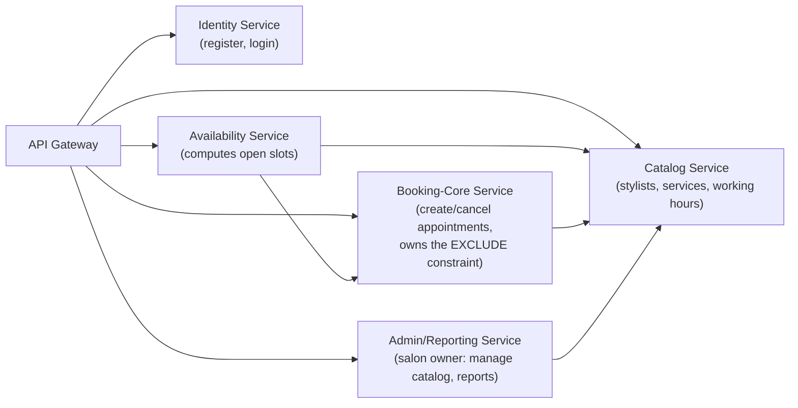

# Cloud-Native Plan (steps 8-11)

This is a design exercise, not a build target: the real code implemented this milestone stays the simple modular monolith described in `ARCHITECTURE.md`. No AWS account exists yet — everything below is theoretical, priced from AWS's public rate card, for execution in a later milestone of this 3-4 month project.

## 8. Cloud-native plan: microservice decomposition + 6R

### Decomposing the Booking/Scheduling service

The one critical service — booking/scheduling — decomposes into 5 microservices, mapped directly onto the existing package boundaries from `ARCHITECTURE.md`:

A 6th candidate, **Notification Service** (appointment reminders), is explicitly out of MVP scope per `README.md` ("email reminders" is listed under out-of-scope) — noted here as the natural extension point once that story is prioritized.

### 6R strategy for 3 systems in the organization

The 6R framework (Rehost/Replatform/Refactor/Repurchase/Retire/Retain) is built for migrating *existing* IT systems to the cloud, so for a salon with no prior software, the honest fit is:

| # | System | Strategy | Justification |
|---|---|---|---|
| 1 | The front-desk paper/Excel appointment log | **Retire** | SalonBooking fully replaces it; there's no data model worth migrating (a handwritten book), so the only "migration" is a process change on launch day. |
| 2 | The salon's standalone card-payment terminal (unconnected to any booking system today; online payments are explicitly out of MVP scope) | **Repurchase** | When payments are eventually integrated, buying a vendor integration (Stripe/Square) is far lower-risk than building custom payment processing — PCI compliance, fraud detection, and card-network integration are the vendor's problem, not ours. |
| 3 | SalonBooking itself, once it needs its first cloud home | **Rehost now, Refactor later** | The containerized monolith (already Dockerized this milestone) lifts as-is onto a container host (step 9) with no code changes — a straight rehost. The microservice split sketched above is deferred until real load data justifies it; this is a deliberate two-stage migration, not an all-at-once rebuild. |

## 9. Serverless, container, or VM?

Three workloads from this (hypothetical, single-salon) organization:

| Workload | Choice | Why |
|---|---|---|
| Booking API (registration, login, availability, booking, cancellation) | **Container** (e.g. AWS ECS Fargate) | Needs a warm JVM and a pooled DB connection (HikariCP) to meet NFR-01 (2s/95th percentile); traffic is steady enough during business hours that serverless cold-starts would hurt tail latency for no cost benefit. |
| Appointment reminder notifications (future story, not in MVP) | **Serverless** (AWS Lambda, triggered per booking or on a schedule) | Bursty, infrequent (tens of invocations/day for a single salon), pay-per-invocation beats paying for an always-on container for sparse work. |
| Nightly admin bookings report for the salon owner | **Serverless** (AWS Lambda on an EventBridge daily schedule) | Runs for a few seconds once a day — a VM or container sitting idle the other 23h59m would be pure waste. |

### Monthly cost estimate: the reminder-notification Lambda

Assumptions: ~30 bookings/day → ~900 reminder invocations/month, 128 MB memory, ~300 ms execution time (one outbound call to an email/SMS API).

- GB-seconds per invocation: 0.125 GB × 0.3 s = 0.0375 GB-s
- Monthly GB-seconds: 900 × 0.0375 = 33.75 GB-s
- Compute cost: 33.75 × $0.0000166667/GB-s ≈ **$0.00056**
- Request cost: (900 / 1,000,000) × $0.20 ≈ **$0.00018**
- **Total ≈ $0.0008/month** — effectively $0, and fully inside AWS Lambda's always-free tier (1M requests + 400,000 GB-s/month free).

Conclusion: at this scale, serverless isn't just architecturally right for a bursty workload — it's free, which is exactly the point of pay-per-use pricing for a single small business.

## 10. Edge and Fog

**Not needed.** SalonBooking has one physical location and no latency-critical or offline-critical path: browsing services, checking availability, and booking an appointment all tolerate a few hundred milliseconds to a centralized cloud region without any user-perceptible impact, and the salon doesn't operate anywhere with unreliable connectivity that would require local processing to keep working.

The one plausible future edge case: if a front-desk check-in kiosk were added and needed to keep operating during a Wi-Fi/ISP outage, a small on-site device caching that day's schedule would be the natural fog pattern. That's speculative and out of scope for the current MVP.

## 11. Quantum risk

Three data types the system holds, ranked by how long they need to stay secret and what to do about it:

| Data type | Required secrecy window | Quantum risk | Where to start |
|---|---|---|---|
| Authentication credentials (BCrypt password hashes; future session tokens) | Indefinite — for the life of the account and beyond, since password reuse elsewhere compounds the blast radius | **Highest.** "Harvest now, decrypt later" attacks target recorded TLS traffic or exfiltrated hash dumps; the actual long-term exposure is any asymmetric key exchange protecting that traffic, not BCrypt itself. | Adopt TLS 1.3 with a hybrid post-quantum key exchange (e.g. X25519+Kyber) as soon as the hosting stack supports it; keep the password-hashing scheme swappable (crypto-agility) rather than hardcoded. |
| Customer PII (name, email; phone if added later) | As long as the account is active, plus a bounded retention window after deletion | **Medium.** Sensitive, but doesn't need multi-decade secrecy the way state or medical secrets would. | Encrypt at rest (column- or disk-level) and enforce strict access control (NFR-04); not primarily a quantum-timeline problem. |
| Appointment/business data (bookings, service prices, schedules) | Short — weeks to months; a past booking has little ongoing sensitivity | **Lowest.** | No special quantum-readiness investment justified here; standard access control is sufficient. |
